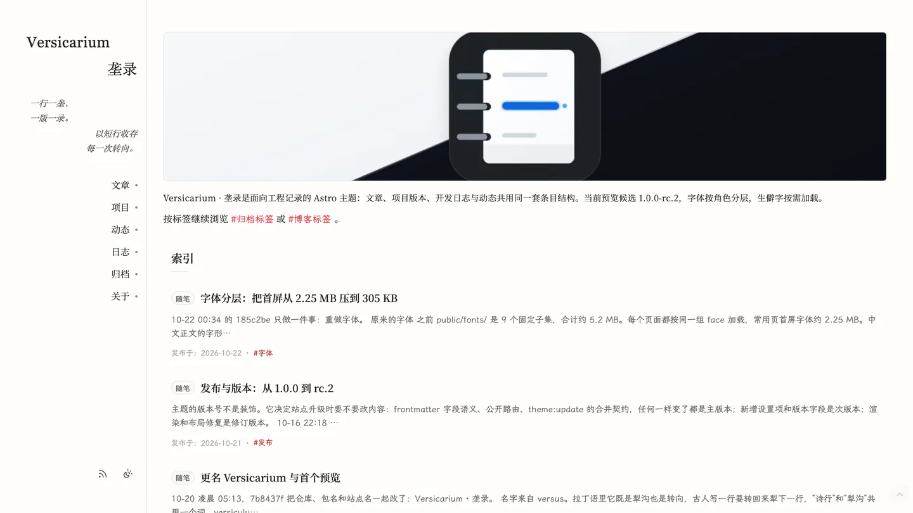
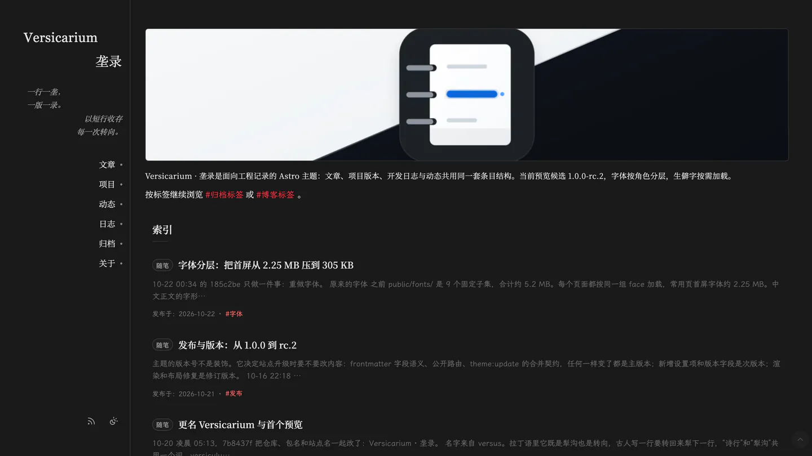
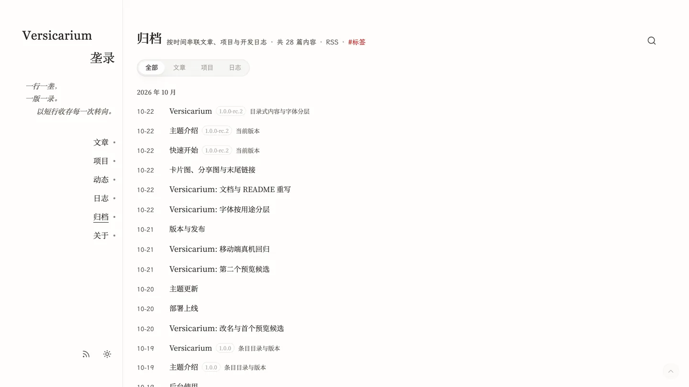
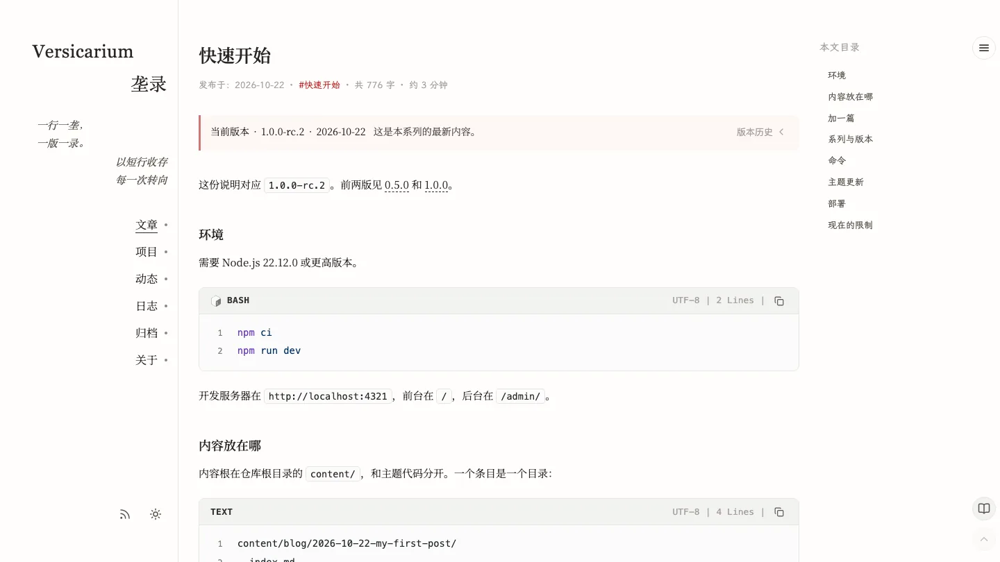
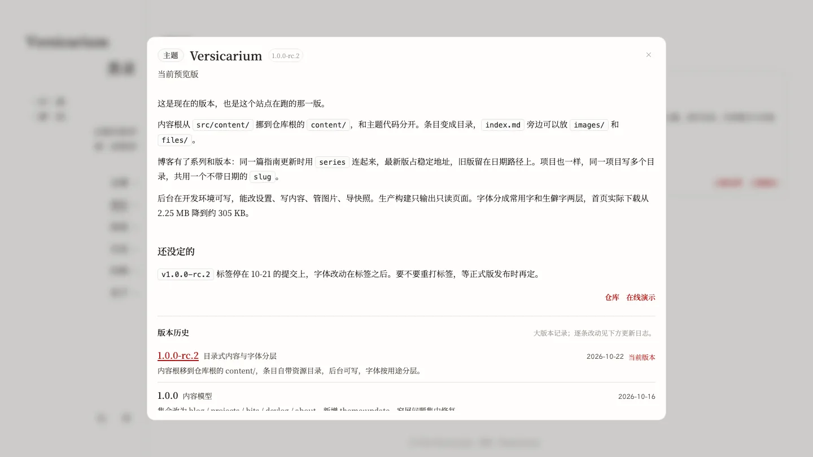
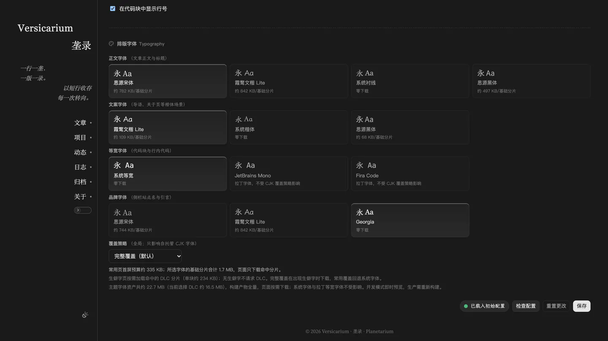
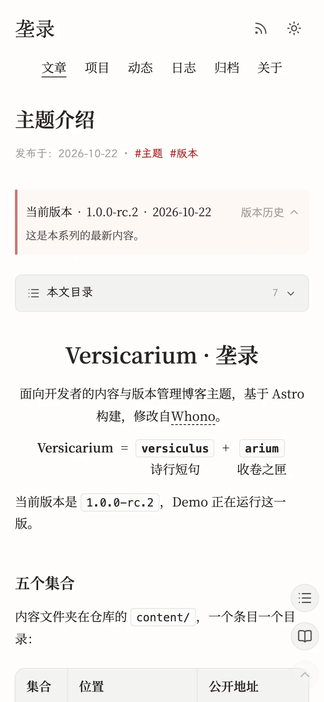

# Versicarium · 垄录

Versicarium 是面向开发者的双栏 Astro 写作主题。技术文章、项目多版本文档、开发日志与短动态共用一套内容结构，开发环境附带可写的后台，主题更新按文件合并，中文字体自托管并按需分片。

名字来自拉丁语 `versus`（犁沟、诗行）与 `-arium`（收存之处），中文名“垄录”接住同一个动作：一行一垄，一版一录。

当前版本 `1.0.0-rc.2`（2026-10-21），第二个预览候选。正式版 `1.0.0` 在预览验证结束后发布。

- 仓库：<https://github.com/planetarium1001/astro-versicarium>
- 示例站：<https://planetarium1001.github.io/astro-versicarium/>
- 上游：<https://github.com/cxro/astro-whono>
- 许可：MIT
- 联系：<mailto:me@planetarium1001.com>

## 截图

截图取自示例站，桌面为 16:9，窄屏为 390×844。

<table>
  <tr>
    <td width="50%"></td>
    <td width="50%"></td>
  </tr>
  <tr>
    <td align="center">首页 · 亮色</td>
    <td align="center">首页 · 暗色</td>
  </tr>
</table>

<table>
  <tr>
    <td width="33%"></td>
    <td width="33%"></td>
    <td width="33%"></td>
  </tr>
  <tr>
    <td align="center">归档</td>
    <td align="center">文章</td>
    <td align="center">项目版本弹窗</td>
  </tr>
</table>

<table>
  <tr>
    <td width="50%"></td>
    <td width="50%"></td>
  </tr>
  <tr>
    <td align="center">后台主题设置 · 亮色</td>
    <td align="center">后台主题设置 · 暗色</td>
  </tr>
</table>

<table>
  <tr>
    <td width="50%"></td>
    <td width="50%"></td>
  </tr>
  <tr>
    <td align="center">窄屏首页</td>
    <td align="center">窄屏文章</td>
  </tr>
</table>

## 功能

| 功能 | 结果 |
| --- | --- |
| 双栏壳层 | 桌面为 224px 侧栏加固定滚动条槽；900px 及以下切单列，页面外缘间隙与窄屏浮动列右侧距离可在后台调整 |
| 五个内容集合 | `blog`、`projects`、`bits`、`devlog`、`about` 各占一个目录，`/archive/` 跨集合按年月归档 |
| 项目多版本文档 | 同一项目可有多个版本文档，共享稳定 `slug`；`/projects/` 每项目一张卡，弹窗切换历史版本，每个版本有独立锚点 |
| 博客系列版本 | `series` 把文章分成版本组，最新版占稳定路径，旧版保留日期路径并标 `noindex`；RSS 与 sitemap 只收最新版 |
| 后台控制台 | 开发环境提供概览、主题、写作、资源与设置快照，其中主题、内容、资源与快照可写；生产构建只输出只读壳，`/api/admin/*` 返回 404 |
| 资源工作区 | 图片与附件按集合、系列、版本浏览，支持批量重命名、移动、删除，显示引用状态，可整条目导入导出 ZIP，也可接对象存储 |
| Markdown 扩展 | 提示块、图注、画廊、`$$` 公式、代码块工具栏、末尾链接组与关于页指令；后台预览与公开渲染共用插件和白名单 |
| 主题更新 | `theme.json` 记录基准提交，`theme:update` 按文件做三方合并；`content/`、设置、字体等站点自有路径不覆盖 |
| 自托管字体 | 按 text/display/meta 角色分片，base 34 个 face、2.21 MB；生僻字 DLC 121 个 face、20.48 MB 按 `unicode-range` 按需下载；默认常用页首屏约 305 KB |
| 部署 | 构建产物是纯静态文件；仓库自带 GitHub Pages、CI、Release Please 与模板打包工作流 |

## 快速开始

需要 Node.js 22.12.0 或更高版本与 npm。`.nvmrc` 固定当前基线 22.22.0。

```bash
npm ci
npm run dev       # 开发服务器，后台入口 /admin/
npm run build     # 静态产物输出到 dist/
npm run preview   # 预览构建产物
```

构建 RSS、canonical、分享图与 sitemap 需要 `SITE_URL`。本地只看页面可以省略；执行 `npm run verify` 或部署前必须提供。

## 获取模板

三种方式得到同一套主题代码，区别在历史、远端与后续更新方式。

### 下载 Release 资产

`release` 工作流在 Release 创建后附加 `astro-versicarium-<version>.zip` 与 `SHA256SUMS`。当前两个预览候选只推送了标签，GitHub Release 尚未创建；以下命令在 Release 创建后可用，以 `1.0.0-rc.2` 为例：

```bash
VERSION=1.0.0-rc.2
BASE="https://github.com/planetarium1001/astro-versicarium/releases/download/v${VERSION}"
curl -LO "${BASE}/astro-versicarium-${VERSION}.zip"
curl -LO "${BASE}/SHA256SUMS"

sha256sum -c SHA256SUMS
# macOS
shasum -a 256 -c SHA256SUMS

unzip "astro-versicarium-${VERSION}.zip"
cd "astro-versicarium-${VERSION}"
npm ci
```

压缩包由 `git archive` 生成，只含已跟踪文件，不含 `node_modules`、`dist`、`demo` 的示例站内容与 Git 历史。解压后长期维护时，直接按浅克隆一节的初始化命令建立自己的仓库，删除 `.git` 那一步可以跳过。

### 使用模板

仓库页面选择 **Use this template**，得到独立历史的仓库。保留完整主题代码与 `main` 上的模板示例条目；后续可用 `npm run theme:update` 接收主题更新。

### 浅克隆 main

```bash
git clone --depth 1 --branch main --single-branch \
  https://github.com/planetarium1001/astro-versicarium.git my-site
cd my-site
npm ci
```

`--depth 1 --single-branch` 只取 `main` 最新提交，不带 `demo` 的完整示例内容与完整历史。克隆得到的 `origin` 指向主题仓库，不能向它推送。作为自有站点时，删除 `.git` 后重新初始化：

```bash
rm -rf .git
git init -b main
git add -A
git commit -m "chore: 初始化站点"
git remote add origin <你的仓库地址>
git push -u origin main
```

## main 与 demo

| 分支 | 内容与用途 |
| --- | --- |
| `main` | 主题代码、默认设置、模板示例条目与文档；模板与主题更新的来源 |
| `demo` | 完整示例站内容与设置，由 `.github/workflows/pages.yml` 部署到 GitHub Pages |

主题改动先在 `main` 完成，再在 `demo` 检出执行 `npm run theme:update` 同步，方向固定为 `main` → `demo`。字体资产属于站点自有路径，`demo` 同步时加 `-- --include-fonts`；示例站内容与模板不同时，再运行 `npm run font:build`。合并规则见 [docs/upstream.md](docs/upstream.md)。

## 常用命令

| 命令 | 作用 |
| --- | --- |
| `npm run dev` | 开发服务器，后台与 `/api/admin/*` 可用 |
| `npm run build` | 构建静态产物到 `dist/` |
| `npm run check` | 类型检查、Svelte 编译与源码守卫 |
| `npm test` | Vitest 用例 |
| `npm run verify` | check、build、字体覆盖检查、fixture 刷新、测试与产物守卫依次执行 |
| `npm run new:bit` | 生成一条动态草稿 |
| `npm run theme:update` | 同步主题更新；`-- --check` 只报告，`-- --include-fonts` 连同字体资产 |
| `npm run font:build` | 重新生成字体 base/DLC 分片、CSS 与清单 |
| `npm run font:check` | 校验字体清单、文件哈希与分片范围 |
| `npm run font:report` | 输出各页面字体预算与 DLC 增量 |

完整命令、守卫与测试组织见 [docs/development.md](docs/development.md)。

## 内容模型

每个条目是一个目录，主文件为 `index.md`；条目内的图片、附件放在 `images/`、`files/`。

| 集合 | 放什么 | 源文件 |
| --- | --- | --- |
| `blog` | 技术文章，可按 `series` 分版本 | `content/blog/<entry>/index.md` |
| `projects` | 项目介绍与多版本文档 | `content/projects/<entry>/index.md` |
| `bits` | 短动态，可配图片与作者 | `content/bits/<entry>/index.md` |
| `devlog` | 按项目归档的开发日志 | `content/devlog/<projectSlug>/<entry>/index.md` |
| `about` | 关于页 | `content/about/index.md` |

`/archive/` 汇总博客、项目版本与开发日志，按年月分组，不含动态。`draft: true` 只在开发环境可见，生产构建、公开列表与 RSS 会过滤。frontmatter、版本规则、图片路径与 Markdown 语法见 [docs/writing.md](docs/writing.md)。

## 设置与后台

设置以 JSON 存放在 `src/data/settings/`，分为 `site.json`、`shell.json`、`home.json`、`page.json`、`ui.json`。字段缺失或非法时回落到内置默认值。

`npm run dev` 下访问 `/admin/` 可读写概览、主题、写作、资源与快照。主题页按站点、侧栏、首页、内页、条目版本、代码显示、排版字体七组编辑，分别写入上面五个文件。生产构建不暴露写入能力。分组、字段与写入流程见 [docs/admin-console.md](docs/admin-console.md)，站点图标见 [docs/favicon.md](docs/favicon.md)。

## 文档

| 文档 | 内容 |
| --- | --- |
| [docs/architecture.md](docs/architecture.md) | 目录分层、集合与路由、服务端边界、设置解析、布局几何、Markdown 管线与构建流程 |
| [docs/development.md](docs/development.md) | 环境、命令、验证流水线、源码与产物守卫、字体管线、测试与命名规范 |
| [docs/writing.md](docs/writing.md) | 五个集合的 frontmatter、博客系列与项目版本、图片附件、末尾链接组与 Markdown 语法 |
| [docs/admin-console.md](docs/admin-console.md) | 后台页面、主题分组、保存与冲突处理、内容编辑、资源工作区、快照与写入流程 |
| [docs/deployment.md](docs/deployment.md) | 分支模型、工作流、环境变量、GitHub Pages 与其他静态托管 |
| [docs/release.md](docs/release.md) | SemVer、Release Please、预览候选、标签、模板打包与 `theme.json` 基线 |
| [docs/upstream.md](docs/upstream.md) | 与上游的关系、改造范围、`theme:update` 三方合并、同步方向与手工合并 |
| [docs/favicon.md](docs/favicon.md) | 图标槽位、生成与回退、本地验证与反向代理放行 |

## 许可与致谢

Versicarium 使用 MIT 许可。主题基于 [cxro/astro-whono](https://github.com/cxro/astro-whono)（MIT）改造，上游提供了双栏壳层、后台框架、Markdown 扩展与字体子集流程的基础。许可证与版权声明见 [LICENSE](LICENSE)。
