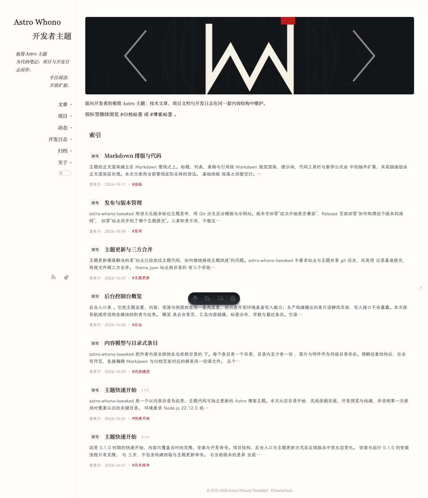

# Versicarium · 垄录

Versicarium 的名字来自一条动作链：`vertere`（转）→ `versus`（犁沟、诗行）→ `versiculus`（短行、短句）→ `-arium`（存放特定事物的场所）。古人像犁地一样逐行书写，写完一行便转向下一行；一行字就是一道垄，`-arium` 把一次次转向留下的短行收存起来。

中文名“垄录”接住同一个动作：垄是犁沟、诗行与代码行，录是记录、收存与归档。品牌句“一行一垄，一版一录。”把行与版本放在同一条尺度上，每一行内容是一道垄，每一个版本是一次收存。

Versicarium 是面向开发者的双栏 Astro 主题，用于发布技术文章、项目多版本文档与开发记录。它基于 [cxro/astro-whono](https://github.com/cxro/astro-whono)（MIT）改造，保留上游的双栏壳层、后台框架、Markdown 扩展与字体子集流程，并增加项目多版本文档、资源工作区与文件级主题同步。

- 仓库：<https://github.com/planetarium1001/astro-versicarium>
- 示例站：<https://planetarium1001.github.io/astro-versicarium/>
- 上游：<https://github.com/cxro/astro-whono>
- 联系：<mailto:me@planetarium1001.com>



文档截图取自示例站，尚未随本次品牌更新重新截取。

## 功能

| 功能 | 说明 |
| --- | --- |
| 双栏壳层 | 224px 侧栏、固定滚动条槽位、可配置页面外缘间隙；窄屏切换为单列 |
| 五个内容集合 | `blog`、`projects`、`bits`、`devlog`、`about`，另有跨集合归档 |
| 项目多版本文档 | 同一项目共享稳定 `slug`，最新版与历史版各自拥有公开锚点与弹窗 |
| 博客系列版本 | `series` 分组，可选稳定 slug，历史版本保留日期路径 |
| 阅读体验 | 目录、阅读模式、浮动操作列、阅读位置记忆、深浅色切换 |
| 后台控制台 | 开发环境可写：概览、主题、写作、资源、快照 |
| Markdown 扩展 | 提示块、图注、画廊、公式、代码工具栏、末尾链接组、关于页指令 |
| 主题更新 | 按 `theme.json` 基准提交做文件级三方合并，站点自有路径不覆盖 |
| 自托管字体 | WOFF2 子集按字符集切分；也可选用 Astro Fonts API 字体 |

## 环境要求与快速开始

需要 Node.js 22.12.0 或更高版本与 npm。版本基线写在 `.nvmrc` 与 `package.json` 的 `engines` 字段。

```bash
npm ci
npm run dev       # 开发服务器，后台入口 /admin/
npm run build     # 静态产物输出到 dist/
npm run preview   # 预览构建产物
```

构建 RSS、canonical、分享图与 sitemap 时需要提供 `SITE_URL`。本地只查看页面可以省略；执行 `npm run verify` 或部署前必须提供。

## 获取模板

以下三种方式得到同一套主题代码，区别在历史、远端与后续更新方式。

### 1. 下载 Release 资产

首个公开版本为 1.0.0，标签 `v1.0.0`。仓库当前尚未创建 Release；Release 创建后，`release` 工作流会附加 `astro-versicarium-1.0.0.zip` 与 `SHA256SUMS`。

```bash
VERSION=1.0.0
BASE="https://github.com/planetarium1001/astro-versicarium/releases/download/v${VERSION}"
curl -LO "${BASE}/astro-versicarium-${VERSION}.zip"
curl -LO "${BASE}/SHA256SUMS"

sha256sum -c SHA256SUMS
# macOS
shasum -a 256 -c SHA256SUMS

unzip "astro-versicarium-${VERSION}.zip"
cd "astro-versicarium-${VERSION}"
npm ci
```

压缩包由 `git archive` 生成，只包含已跟踪文件；未跟踪的演示截图、`node_modules`、`dist` 与本地缓存不会进入，也不包含 Git 历史。解压后如需长期维护，按“浅克隆 main”一节的步骤初始化仓库。

### 2. 使用模板

在仓库页面选择 **Use this template**，得到独立历史的仓库。该方式保留完整主题代码，不携带示例站内容；后续可用 `npm run theme:update` 接收主题更新。

### 3. 浅克隆 main

```bash
git clone --depth 1 --branch main --single-branch \
  https://github.com/planetarium1001/astro-versicarium.git my-site
cd my-site
npm ci
```

`--depth 1` 只取 `main` 的最新提交，`--single-branch` 不抓取 `demo`。这样不会带入示例站内容，也不会下载完整历史；主题更新依赖 `theme.json`，不依赖站点本地的提交深度。

克隆得到的 `origin` 指向主题仓库，不能向它推送。准备作为自有站点时，删除 `.git` 后重新初始化：

```bash
rm -rf .git
git init -b main
git add -A
git commit -m "chore: 初始化站点"
git remote add origin <你的仓库地址>
git push -u origin main
```

## main 与 demo

| 分支 | 角色 |
| --- | --- |
| `main` | 最小模板与主题更新来源，不包含示例站内容 |
| `demo` | 完整示例站，部署到 GitHub Pages |

主题改动先在 `main` 完成，再在 `demo` 检出上执行 `theme:update` 同步；不反向合并。`demo` 由 `.github/workflows/pages.yml` 构建并发布到示例站。

## 命令

| 命令 | 作用 |
| --- | --- |
| `npm run dev` | 启动开发服务器，后台与 `/api/admin/*` 可用 |
| `npm run build` | 构建静态产物到 `dist/` |
| `npm run check` | 类型检查、Svelte 编译与源码类守卫 |
| `npm test` | Vitest 用例 |
| `npm run verify` | check、build、刷新 fixture、test 与产物校验依次执行 |
| `npm run ci` | 等价于 `verify`，CI 使用 |
| `npm run new:bit` | 生成一条动态草稿 |
| `npm run theme:update` | 同步主题更新；加 `-- --check` 只报告 |
| `npm run font:build` | 重算字符集并重建字体子集 |

## 目录结构

```text
content/            作者内容：五个集合，条目含 index.md 与 images/、files/
src/pages/          路由；admin/ 与 api/admin/ 仅开发环境可用
src/layouts/        BaseLayout、ArticleLayout
src/components/     展示组件；admin/ 为后台界面
src/lib/            设置解析、内容读取、路由模型与后台逻辑
src/scripts/        客户端脚本；admin-*/ 仅开发环境加载
src/styles/         样式入口与组件样式
src/plugins/        Markdown 管线与 HTML 白名单
src/utils/          日期、slug、格式化与路径规则
src/data/settings/  五个主题设置 JSON
public/             静态资源：字体、头像、默认图标、上传图片
scripts/            校验、字体子集、new:bit、theme:update
tools/              字符集基线、指纹与图标生成标记
tests/              Vitest 用例与页面快照
docs/               仓库文档
```

## 内容模型与写作入口

| 集合 | 源文件 | 公开路由 |
| --- | --- | --- |
| `blog` | `content/blog/<entry>/index.md` | `/blog/`、`/blog/<slug>/` |
| `projects` | `content/projects/<entry>/index.md` | `/projects/`、`/projects/#<anchor>` |
| `bits` | `content/bits/<entry>/index.md` | `/bits/` 页内锚点 |
| `devlog` | `content/devlog/<projectSlug>/<entry>/index.md` | `/devlog/` 页内锚点 |
| `about` | `content/about/index.md` | `/about/` |

`/archive/` 汇总博客、项目与开发日志，按年月分组，不含动态。项目按版本文档成行，并可在全部版本与最新版之间切换。

写作入口有三种：后台写作页、直接新增条目目录与 `index.md`、`npm run new:bit` 生成动态草稿。`draft: true` 只在开发环境可见，生产构建、公开列表与 RSS 会过滤。

frontmatter、项目与博客版本规则、图片路径与 Markdown 语法见 [docs/writing.md](docs/writing.md)。

## 主题设置与后台

设置以 JSON 存放在 `src/data/settings/`，分为 `site.json`、`shell.json`、`home.json`、`page.json`、`ui.json`。字段缺失或非法时回落到内置默认值，来源与可编辑快照由 `src/lib/theme-settings.ts` 统一解析。

`npm run dev` 下访问 `/admin/` 可读写概览、主题、写作、资源与快照；生产构建输出只读静态壳，`/api/admin/*` 返回 404。分组、字段与写入流程见 [docs/admin-console.md](docs/admin-console.md)，站点图标见 [docs/favicon.md](docs/favicon.md)。

## 主题更新

`theme.json` 记录主题仓库、跟踪分支与上一次合并到的提交，字段为 `repository`、`branch`、`commit`。

```bash
npm run theme:update -- --check   # 只报告变更
npm run theme:update              # 合并并更新基准提交
```

更新前工作树必须干净。脚本按文件读取基准版本、主题新版本与站点当前版本，文本文件使用 `git merge-file --diff3`，二进制文件整文件取舍。

| 情况 | 处理 |
| --- | --- |
| 站点未改动该文件 | 采用主题新版本 |
| 主题未改动该文件 | 保留站点版本 |
| 双方都改动 | 三方合并，冲突保留标记并列入报告 |
| 二进制文件双方都改过 | 保留站点版本并记为冲突 |
| 站点自有路径 | 不覆盖，只在报告中列出 |

站点自有路径：`content/`、`src/data/settings/`、`public/images/`、`public/author/`、`public/fonts/`、`tools/`、`tests/fixtures/`、`README.md`、`theme.json`、`.github/workflows/pages.yml`。

存在冲突时命令以非零状态退出且不更新 `theme.json`；解决冲突后重跑。主题删除的文件只列入报告，不自动移除。合并完成后执行 `npm run verify`。站点定制应放在站点自有路径或独立模块中，避免与主题文件产生长期冲突。

## 版本与发布

当前为 1.0.0 预览版，也是首次公开版本，标签为 `v1.0.0`。仓库当前尚未创建 Release。

版本号与 `CHANGELOG.md` 由 Release Please 管理：提交遵循 Conventional Commits，Release Please 维护版本与变更记录，合并 release PR 时创建标签与 GitHub Release。Release 创建后，`.github/workflows/release.yml` 校验标签与版本号一致，并将模板 zip 与 `SHA256SUMS` 附加到该 Release。

版本号遵循 SemVer，版本不嵌入日期；日期只写入 CHANGELOG 与 Release 标题。版本策略、发布清单、模板打包与下载校验见 [docs/release.md](docs/release.md)。

## 部署

`demo` 由 `.github/workflows/pages.yml` 构建并发布到 GitHub Pages。部署自己的站点时，修改工作流中的部署分支与检出引用，或直接上传 `dist/` 到任意静态托管。

| 变量 | 作用 |
| --- | --- |
| `SITE_URL` | 站点 origin，用于 RSS、canonical、分享图与 sitemap；缺失时不生成 sitemap |
| `ASTRO_WHONO_BASE_PATH` | 部署子路径，默认 `/`；项目页部署在仓库子路径时使用，例如 `/astro-versicarium/` |

GitHub Pages、自有域名与其他静态托管的配置见 [docs/deployment.md](docs/deployment.md)。

## 文档

| 文档 | 内容 |
| --- | --- |
| [docs/architecture.md](docs/architecture.md) | 目录分层、集合与路由、服务端边界、设置解析、布局与构建流水线 |
| [docs/development.md](docs/development.md) | 环境、命令、验证流水线、fixture、字体、测试与命名规范 |
| [docs/writing.md](docs/writing.md) | 五个集合的 frontmatter、版本规则、图片路径与 Markdown 语法 |
| [docs/admin-console.md](docs/admin-console.md) | 后台页面、主题字段、内容编辑器、资源与快照写入 |
| [docs/deployment.md](docs/deployment.md) | 分支模型、工作流、环境变量、GitHub Pages 与静态托管 |
| [docs/release.md](docs/release.md) | SemVer、Release Please、1.0.0 预览、标签、模板打包与 `theme.json` 基线 |
| [docs/upstream.md](docs/upstream.md) | 与上游的关系、改造范围、同步方向与手工合并 |
| [docs/favicon.md](docs/favicon.md) | 图标槽位、生成、回退、本地路径与反向代理放行 |

## 许可与致谢

Versicarium 基于 [cxro/astro-whono](https://github.com/cxro/astro-whono)（MIT）改造，使用 [Astro](https://astro.build/) 构建。上游提供了双栏壳层、后台框架、Markdown 扩展与字体子集流程的基础，在此致谢。许可证见 [LICENSE](LICENSE)。
