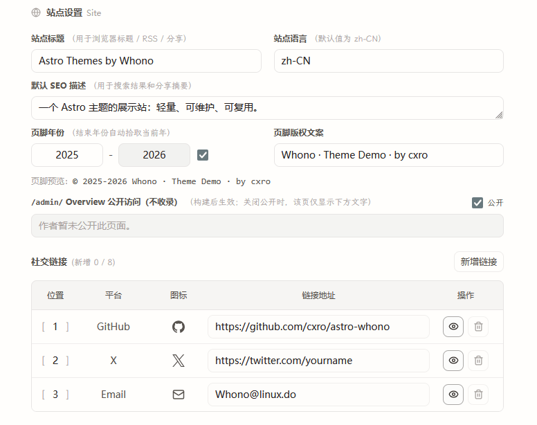

后台「资源」页面把图片和附件放在同一个工作区里。

## 快速上手

1. 从左侧目录树选择内容集合、系列、版本或目录。
2. 在顶部搜索、按类型或引用状态筛选。
3. 选中条目后上传图片或附件，文件会落到当前条目的 `images/` 或 `files/`。
4. 选中多个文件可以批量重命名、移动或删除。
5. 在详情抽屉里复制路径、复制 Markdown 引用，或导出整个条目压缩包。

[下载说明附件](./files/readme.txt)
