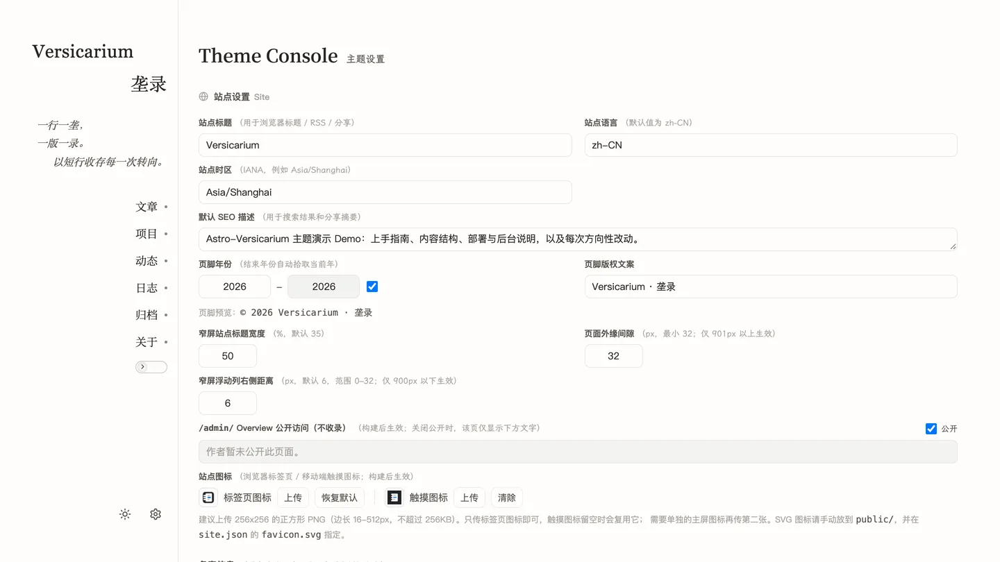

# 后台使用

## 范围

本篇覆盖：后台五个页面的用途与操作、可写与只读的边界。前置：本地已能启动站点，见[安装与运行](install.md)。

## 可写范围

- 只在开发环境可写：运行 `npm run dev` 后打开 `http://localhost:4321/admin/`。
- 后台入口在侧栏底部，也可以在站点地址后加 `/admin/` 直接打开。
- 构建出来的线上站点只读：没有写入入口，后台接口只返回占位响应。
- 后台直接读写仓库文件，不需要数据库，也不会自动提交。
- 设置与内容改完刷新页面生效；线上要重新构建才会更新。

## 五个页面

| 侧栏名称 | 路由 | 作用 |
|---|---|---|
| 概览 | `/admin/` | 内容数量、热门标签、总字数、最近条目与写作活动 |
| 主题 | `/admin/theme/` | 七组主题设置 |
| 写作 | `/admin/content/` | 五个内容区的条目管理 |
| 资源 | `/admin/resources/` | 图片与附件管理 |
| 快照 | `/admin/data/` | 设置的导出与导入 |

- 后台没有账号与登录，只在本地开发环境可访问。
- 线上访问后台地址时，只显示只读提示，不出现编辑控件。
- 主题页的七组设置与字段说明见[主题设置](settings.md)。

## 后台写入了什么

- 内容写入 `content/` 下对应分区的条目目录。
- 设置写入 `src/data/settings/` 的五个文件。
- 上传的图片写入条目目录或共享目录；配置云端存储后写入云端。
- 快照页只处理设置，不碰内容与图片。

## 概览页

- 顶部四个数字：文章数量、标签数量、文字统计、距上次更新。
- 内容结构按五个分区列出条目数与占比。
- 热门标签、最近条目，以及最近 90 天的写作活动。
- 本地会列出草稿并标注「草稿仅 DEV 可见」。
- 概览页是否公开由站点设置决定；关闭时显示设置里的提示文字。

## 主题页

- 七组设置：站点设置、侧栏设置、首页设置、内页设置、条目版本、代码显示、排版字体。
- 检查配置：只校验并列出会变化的项，不写文件。
- 保存：只写入有变化的分组，没有变化的分组不动。
- 重置更改：放弃本轮修改，回到文件里的当前内容。
- 设置文件在别处被改过时，页面提示外部更新，并保留你填的内容。
- 出现外部更新时保存会暂停；点「重置更改」同步最新内容，或点「重新检测」重新读取状态。
- 保存前比对设置文件的版本号；另一个窗口先保存过时，本次保存暂停并提示外部更新。
- 保存成功后提示「保存成功」，页面内容回到文件里的最新状态。
- 检查配置的结果按字段列出，确认后再保存。
- 设置文件格式错误时进入只读状态，列出出问题的文件、位置与原始错误。
- 修好文件后点「重新检测」；只读状态解除前，保存与重置都不可用。
- 保存后刷新页面生效；换字体要重启 `npm run dev`。

## 写作页

- 五个区：文章、项目、动态、开发日志、关于页，切换分区后列表只显示该区内容。
- 列表可按区、草稿状态、年份、标签、排序与关键词筛选。
- 草稿状态分全部、已发布、仅草稿三种。
- 新建条目默认是草稿，列表里会标出；取消草稿即发布。
- 编辑器提供 Markdown、预览、大纲，以及图片、画廊、公式、折叠内容与摘要分隔的插入。
- 编辑时预览随输入更新；字段不合规时保存会被拒绝，并列出问题位置。
- 博客条目按系列分组，项目按标识分组，展开后编辑各自的版本；总览同样列出完整版本。
- 「新建版本」只对博客条目开放：以系列最新版为模板生成一份新草稿。
- 删除的条目移到回收站目录，不会立刻从磁盘消失，需要时可以手动移回。
- 批量操作支持改发布状态、删除与导出源文件，一次最多 200 条。
- 关于页是固定单页，只能编辑正文。
- 保存博客正文时，正文引用的本地图片不存在会拒绝保存。
- 正文写法与图片引用见[内容与写作](content.md)。

## 资源页

- 单页工作区：左侧目录按内容区、系列、版本或条目展开，共享资源是每个内容区共用的一份。
- 上传的文件放到当前条目目录；选择共享资源时放到共享目录。
- 上传后文件出现在左侧对应节点下，可继续在详情里复制引用。
- 文件名会自动整理，重名时追加序号。
- 可按内容区、系列、版本、目录、引用状态、类型、日期与关键词筛选，条件写在地址里。
- 网格与列表两种视图，可批量重命名、移动、删除；改名或移动会同步改写正文里的引用。
- 引用状态分三种：已引用、未引用、孤儿。孤儿指条目已删除、文件还留在磁盘上。
- 详情里可复制路径或 Markdown 引用，也可把整个条目导出成 ZIP。
- 「导入条目」接受条目 ZIP，只新建条目，不覆盖已有内容。
- 配置云端存储后，上传的图片进入云端，列表一起显示；没有配置时只用本地文件。

## 快照页

- 只导出与导入设置，文件是 JSON。
- 导出的快照含设置与说明信息，不含内容、图片与密钥，不能当作整站备份。
- 导入前先比对并展示会变化的设置，确认后才写入。
- 比对结果可以放弃，放弃时不写任何文件。
- 设置文件损坏时，快照页与主题页一样进入只读状态。

## 页面之间的配合

- 新建条目：写作页新建，编辑正文，资源页上传图片，正文引用后取消草稿发布。
- 改外观：主题页改七组设置，保存后刷新页面。
- 备份设置：快照页导出 JSON；需要整站备份时提交仓库。

## 注意事项

- 不要一边用后台编辑，一边手动改同一个设置文件。
- 后台的界面偏好（顶部导航、侧栏模式、编辑器布局）只存在当前浏览器，不写进仓库。
- 内容与设置写的是仓库文件，改完照常提交。
- 线上想改内容或设置，要改仓库文件后重新构建发布。
- 后台不提供整站备份；需要备份时提交仓库，或单独保存内容与图片。
- 删除的条目先到回收站，确认不再需要后再清理。
