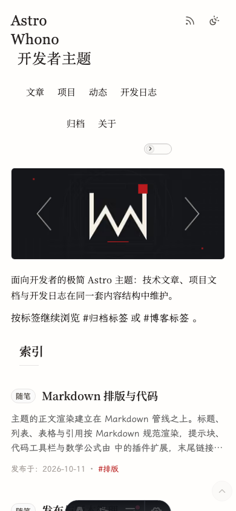

# 架构

Versicarium 的代码按内容边界、主题代码与构建管线分层：作者内容位于 `content/`，可更新代码位于 `src/`，主题更新只覆盖主题负责的部分。

## 目录分层

| 目录 | 职责 |
| --- | --- |
| `content/` | 作者内容，按集合分目录；条目包含 Markdown 主文件与 `images/`、`files/`、`assets/` |
| `src/pages/` | 页面与 API 路由；`admin/` 与 `api/admin/` 的写入仅开发环境可用，`checks/` 为内部冒烟页 |
| `src/layouts/` | `BaseLayout` 与 `ArticleLayout` |
| `src/components/` | 展示组件；`admin/` 只被后台页面引用 |
| `src/lib/` | 设置解析、内容读取、路由模型、归档与后台逻辑 |
| `src/lib/admin-console/` | 后台专用契约、读写、媒体索引与设置校验 |
| `src/scripts/` | 客户端脚本；`admin-*/` 只在开发环境加载 |
| `src/styles/` | 样式入口与组件样式；`components/admin/` 为后台样式 |
| `src/plugins/` | Markdown 管线、HTML 白名单与关于页指令 |
| `src/utils/` | 日期、slug、路径、格式化与时区工具 |
| `src/data/settings/` | 五个主题设置 JSON |
| `public/` | 静态资源与运行时生成资源 |
| `scripts/` | 校验、字体子集、`new:bit`、`theme:update` |
| `tests/` | Vitest 用例与页面快照 |
| `tools/` | 字符集基线、指纹与图标生成标记 |

## 内容集合与路由

集合定义在 `src/content.config.ts`，由 `src/lib/content-loader.ts` 的 `entryDirLoader` 加载。每个条目是一个目录，主文件按 `index.md`、唯一 `.md`、唯一 `entry: true` 的顺序确定；集合根目录下的 Markdown 文件会被拒绝。`about` 使用固定页面加载器，只读取 `content/about/index.md`。

| 集合 | 内容根 | 公开路由 |
| --- | --- | --- |
| `blog` | `content/blog/<entry>/` | `/blog/`、`/blog/<slug>/` |
| `projects` | `content/projects/<entry>/` | `/projects/`，条目以 `#<anchor>` 打开弹窗 |
| `bits` | `content/bits/<entry>/` | `/bits/`，条目以 `#bit-<entryId>` 定位 |
| `devlog` | `content/devlog/<projectSlug>/<entry>/` | `/devlog/`，条目以压平后的 `#<entryId>` 定位 |
| `about` | `content/about/index.md` | `/about/` |

`/archive/` 聚合博客、项目版本与开发日志，按年月分组，不含动态；`archive.versionMode` 决定项目显示全部版本还是仅最新版。`/blog/index.json`、`/bits/index.json`、`/archive/index.json` 为客户端筛选与计数提供数据；`/blog/rss.xml` 与 `/rss.xml` 输出博客订阅源，每个系列只发最新版。

路由前缀由 `astro.config.mjs` 的 `base` 决定，环境变量为 `ASTRO_WHONO_BASE_PATH`；站内链接经 `createWithBase()` 拼接，`trailingSlash` 固定为 `always`。sitemap 只在 `SITE_URL` 非空时生成，构建后按 `/blog/index.json` 的 canonical 列表移除历史版本与 latest dated alias，并排除 `/admin/` 与 `/checks/`。

## 服务端与客户端边界

开发环境 `output` 为 `server`，允许后台与 `/api/admin/*` 读写；生产构建切换为 `static`，后台页面输出只读壳，写入接口返回 404。页面在构建时渲染完整列表与正文，无 JavaScript 时仍可阅读与导航。

筛选、搜索、分页与标签表达式只操作已渲染的 DOM，不从 JSON 重建列表；`index.json` 用于补充计数与筛选数据。客户端入口在 `src/scripts/`，由布局或页面以模块脚本引入：

| 脚本组 | 职责 |
| --- | --- |
| `article-toc.ts` | 目录展开、滚动高亮、跳转高亮与状态持久化 |
| `sidebar-*.ts` | 侧栏导航、主题切换、阅读模式、浮动操作列、阅读位置记忆 |
| `entry-search.ts`、`tag-expression.ts`、`*-filter*` | 列表搜索、标签表达式、年份与项目筛选 |
| `dialog-controller.ts` | 卡片详情弹窗的通用交互 |
| `view-stats.ts` | 浏览数据取数接入点，默认空实现 |
| `admin-*/` | 后台行为，仅开发环境加载 |

浏览数据是真实存在的可选槽位，不是第三方统计集成。布局渲染 `[data-view-stats]`，带 `data-view-scope`、`-path`、`-route`、`-title`；每个指标是 `[data-view-stat="pv|uv"]` 内的 `[data-view-stat-value]`，未填值时保持 `hidden`。`src/lib/view-stats.ts` 提供 `resolveViewStats()`、`setViewStatValue()` 与 `VIEW_STATS_READY_EVENT`，站点在 `src/scripts/view-stats.ts` 中自行取数。

## 设置解析

主题设置以 JSON 存放在 `src/data/settings/`，分为 `site.json`、`shell.json`、`home.json`、`page.json`、`ui.json`。`src/lib/theme-settings.ts` 逐字段校验类型、范围与路径，缺失或非法值回落到内置默认值，同时记录每个字段来自文件、兼容旧值还是默认值。

可编辑快照带 `revision`，由规范化后的设置计算；后台保存时以此校验并发修改。读取阶段的 JSON 语法错误、根节点类型错误或需要静默修补的字段会进入只读诊断状态，渲染仍使用兜底值。生产构建缓存解析结果，开发环境每次读取；`ui.json` 的字体选择在 Astro 配置期读取，修改后需重启开发服务器。

## 壳层与布局几何

样式入口为 `src/styles/global.css`。桌面壳层为三列：`--sidebar`（224px）、1px 分隔线、内容列。页面外缘间隙由 `site.pageGapPx` 控制，构建期以 `<html>` 内联自定义属性输出 `--page-gap-inline` 与 `--page-inline`；后者等于间隙减去 `--scrollbar-gutter-inline`（15px）。窄屏（≤ 900px）改为单列，间隙归零；触屏滚动条为浮层，由 `layout.css` 单独覆盖。

首屏 critical CSS 是 `src/pages/index.astro` 内的手写快照，位于 `global.css` 之后。`check:home-critical-css` 比对快照与 `global.css`、`layout.css` 的壳层、窄屏顶栏与浮动列声明；`check:layout-geometry` 与 `check:touch-targets` 读取构建产物，断言间距不变量与触控尺寸。布局改动需同时通过这些检查，细节见 [development.md](development.md)。

## Markdown 管线

公开页面使用 `src/plugins/markdown-pipeline.mjs` 组装的 unified 处理器，由 `astro.config.mjs` 的 `markdown.processor` 接入。Astro 内建的 GFM 与 smartypants 先执行，项目插件随后处理：

- remark：`remark-math`、`remark-directive`、关于页指令与提示块；
- rehype：数学边界保护、原始 HTML 放行、统一白名单清洗、KaTeX 渲染与代码块工具栏；
- 代码高亮：Shiki，浅色 `github-light`、深色 `github-dark`。

单个 `$` 不作为公式定界符。后台预览使用显式 unified 处理器，与公开管线共享同一份插件与白名单；差异仅在标题 id 与预览专用属性。`projects` 与 `devlog` 的末尾链接组由 `src/lib/trailing-links.ts` 解析，正文渲染与摘要派生都先剥离链接行再附加统一标记。写法见 [writing.md](writing.md)。

内容附件（PDF、压缩包等非图片文件）从条目目录引用时，构建期由 `src/integrations/content-assets.mjs` 复制到 `dist/content-assets/`，只复制被 Markdown 或 HTML 链接引用的文件。正文图片仍按普通图片路径解析。

## 后台 API 边界

后台页面路由为 `/admin/`、`/admin/theme/`、`/admin/content/`、`/admin/resources/`、`/admin/data/`；内容编辑页为 `/admin/content/[collection]/_edit/[...entryId]/`。`/admin/images/` 在 `astro.config.mjs` 中重定向到 `/admin/resources/`。页面结构与字段见 [admin-console.md](admin-console.md)。

API 位于 `src/pages/api/admin/`，分为内容、媒体与图片、主题设置、数据快照、预览五组。所有处理函数先检查 `import.meta.env.DEV`，非开发环境返回 404；写入还要求同源 `Origin`/`Referer` 与正确的 `Content-Type`，设置与内容请求另需 `revision`。设置、内容与站点资源分别使用写队列，落盘通过临时文件与重命名完成，失败时回滚；检测到外部更新时返回 409 并带回最新快照。

## 构建流水线

`npm run build` 先由 `prebuild` 执行 `scripts/favicon.mjs`，再进入 `astro build`。配置期根据 `SITE_URL` 决定是否注册 sitemap，根据 `ui.json` 注册 Astro Fonts API 字体，并把部署 `base` 传给 Markdown 与内容资源插件。

构建阶段主要步骤：

1. `entryDirLoader` 读取五个集合，解析 frontmatter 并渲染 Markdown；
2. `contentAssets` 复制被引用的内容附件；
3. Astro 生成静态页面、RSS、robots 与 sitemap；
4. sitemap 插件移除非 canonical 的博客 URL；
5. `verify` 在产物上执行 fixture、测试与产物类守卫。

完整命令与守卫清单见 [development.md](development.md)，部署变量见 [deployment.md](deployment.md)。
