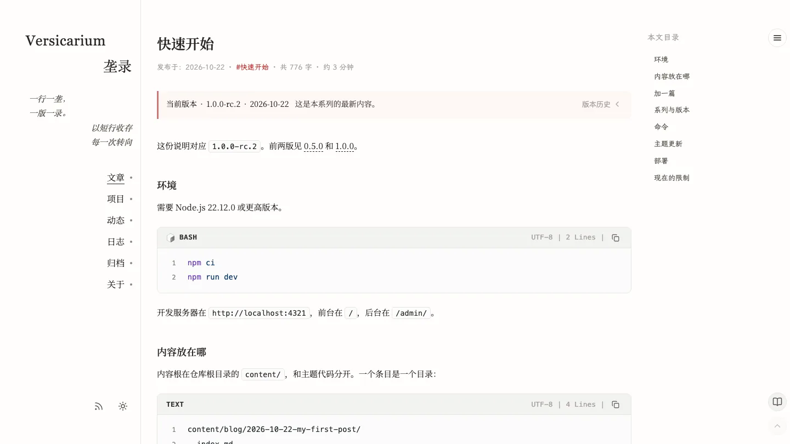
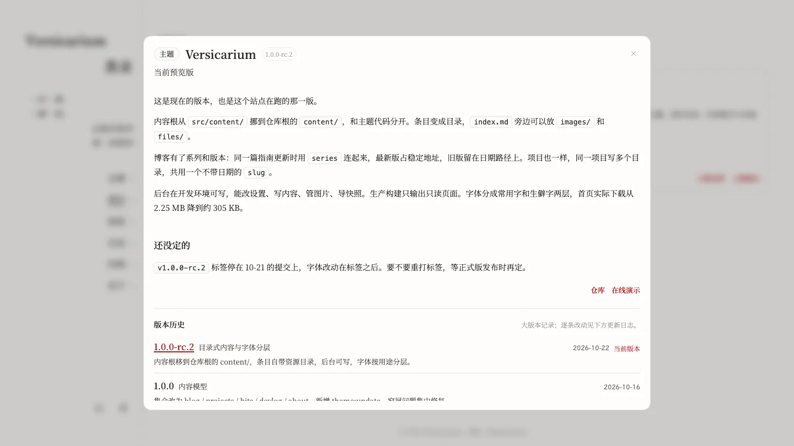

# 内容与写作

## 范围

本篇覆盖：五个内容区、文件开头的设置、版本线与内容系列、时间字段写法、正文写法、图片与附件。前置：站点能在本地运行，见[安装与运行](install.md)。

## 内容放在哪

内容都在 `content/`，一个条目一个目录，主文件是 `index.md`。

| 区 | 内容 | 位置 |
|---|---|---|
| 文章 | 长文，可以按版本线保留多版，也可以组成系列 | `content/blog/` |
| 项目 | 项目介绍与历史版本 | `content/projects/` |
| 动态 | 短记录、图片与作者 | `content/bits/` |
| 开发日志 | 按项目归档的开发进展 | `content/devlog/` |
| 关于页 | 固定的单页介绍 | `content/about/` |

- 文章、项目与开发日志的目录名写成 `2026-05-01-标题`；开发日志再套一层项目目录 `content/devlog/<项目>/<条目>/`；动态用 `bits-2026-05-01-0930`，`npm run new:bit` 会按当前时间生成。
- 目录里只有一个 Markdown 文件时，主文件可以不起名 `index.md`；有多个 Markdown 文件时，给主文件标 `entry: true`。

新建内容有两种方式：后台（`npm run dev` 后打开 `/admin/`，在写作页选区新建，目录、主文件与常用设置自动生成）或手动建目录与 `index.md`。

草稿只在本机可见：文件开头写 `draft: true`，开发环境能看到，构建后的站点、列表与订阅源都会跳过；准备好后改回 `draft: false` 再发布。

## 文件开头的设置

文件开头两行 `---` 之间的内容决定标题、日期与是否公开。

| 字段 | 用途 |
|---|---|
| `title` | 标题。动态可以省略 |
| `date` | 日期。写 `2026-05-01`，也可以带时间与时区，见下文「时间字段写法」 |
| `description` | 一句话摘要，列表与搜索会用到 |
| `tags` | 标签列表，例如 `[记录, 整理]` |
| `draft` | 草稿。`true` 时只在本机可见 |

各区的必填项不同：文章与项目要 `title` 与 `date`，动态只要 `date`，开发日志要 `title`、`date`、`project`，关于页不需要任何字段。日期格式写错时构建直接报错。文章还可以加版本线与系列字段，见下一节。

<details>
<summary>一篇文章开头的设置</summary>

```markdown
---
title: <TITLE>
date: <DATE>
description: <SUMMARY>
tags: [<TAG-1>, <TAG-2>]
draft: false
---

正文从这里开始。
```

- `<TITLE>`、`<DATE>`、`<SUMMARY>` 换成标题、日期与摘要。
- `<TAG-1>`、`<TAG-2>` 换成标签。

</details>

## 版本线与内容系列

普通文章不需要额外设置。有两类字段按需添加，作用不同：版本线表示同一篇内容的多次改版，内容系列表示同一主题下并列的独立文章。两者互不影响，一篇文章可以同时属于一个版本线和一个系列。

### 版本线（versionGroup）

新版会取代旧版、读者只需读最新那份时，用版本线。每个版本一个目录，各自写日期，所有版本填同一个 `versionGroup`。

| 字段 | 用途 |
|---|---|
| `versionGroup` | 版本线标识，同一内容的各版本保持一致；规则同 `slug` |
| `versionLabel` | 版本号，例如 `0.5.0`、`v2` |
| `versionName` | 版本的可读名，例如「早期版本」；缺省用标题 |
| `versionSummary` | 该版本的摘要；缺省用 `description` |
| `versionOrder` | 同一天的多个版本之间的次序，非负整数，越大越新；缺省按 `0` 参与排序 |

- 排序是 `date` 倒序 → `versionOrder` 倒序 → 条目 ID，排在最前的是最新版。
- 需要固定地址时各版本写同一个 `slug`：最新版占 `/blog/<slug>/`，历史版本留在 `YYYY-MM-DD-...` 日期地址上并带 `noindex`，读者仍能读到。同组 `slug` 必须一致，否则构建报错。
- 历史版本的文章页有提示条和版本抽屉，可以跳回最新版；订阅源与 sitemap 只收录最新版。

<details>
<summary>两个版本的写法</summary>

```markdown
---
title: <TITLE>
date: <DATE>
versionGroup: <VERSION-GROUP>
versionLabel: <VERSION-LABEL>
versionName: <VERSION-NAME>
versionOrder: 2
slug: <VERSION-GROUP>
---
```

- `<VERSION-GROUP>` 换成版本线标识，所有版本保持一致；`<VERSION-LABEL>` 换成版本号；`versionOrder` 写同一天的次序，越大越新。
- 最后一行是地址标识，与版本线标识相同，不需要固定地址时删掉。

</details>

项目不用 `versionGroup`：每个版本一个目录，所有版本填同一个稳定 `slug`，再分别写 `versionLabel` 与 `versionName`；项目列表只显示最新版，点开卡片可以切换其他版本。





### 内容系列（series）

同一主题下的一组独立文章用内容系列串起来，每篇都是完整有效的文章，按次序阅读。

| 字段 | 用途 |
|---|---|
| `series` | 系列标识，同一系列填同一个值；规则同 `slug` |
| `seriesName` | 系列显示名；缺省回退 `series` |
| `seriesOrder` | 阅读次序，非负整数，越小越靠前；缺省排在最后 |

- 排序是 `seriesOrder` 升序 → `date` 升序 → 条目 ID，序号就是排序后的第几篇。
- 系列不改变任何文章的地址，也不产生「最新版 / 历史版」：成员之间平等，不会互相标记过时。
- 文章页有「同系列」抽屉，按序号列出全部成员并标出正在阅读的一篇；系列只有一篇时不显示。
- 同一篇内容的多个版本在系列清单里只占一行，取最新版那一条。
- `/blog` 的筛选面板里，系列排在标签区块下面，与标签共用同一套筛选表达式和 `+` / `/` 开关，可以多选；链接形如 `/blog/?tags=series%3A<slug>&mode=and`。
- 条目上的系列呈现由主题设置的两组选项决定，见[主题设置](settings.md#条目系列)。

<details>
<summary>三篇同系列的写法</summary>

```markdown
---
title: <TITLE>
date: <DATE>
series: <SERIES-ID>
seriesName: <SERIES-NAME>
seriesOrder: 2
---
```

- `<SERIES-ID>` 三篇保持一致；`<SERIES-NAME>` 换成系列显示名，写在其中一篇也可以，缺省用 `<SERIES-ID>`。
- `seriesOrder` 按阅读次序写 1、2、3，公开侧的序号随之确定。

</details>

### 何时用哪个

- 新版取代旧版，旧版只作为历史留存：用 `versionGroup`。
- 多篇文章各自成立、合起来才完整：用 `series`。
- 两件事都要时同时写：版本线决定「哪一份是新的」，系列决定「按什么顺序读」。

### 时间字段写法

`date`、`publishedAt`、`updatedAt` 接受同一组写法：

| 写法 | 例子 |
|---|---|
| 日期 | `2026-11-09`、`2026/11/09` |
| 日期 + 时间，无时区 | `2026-11-09 14:30`、`2026-11-09T14:30`、`2026-11-09 14:30:00` |
| 带时区 | `2026-11-09T06:30Z`、`2026-11-09T14:30+08:00`、`2026-11-09 14:30:00+08:00` |

- 没写时区的时间按站点时区解释：`SITE_TIMEZONE` 优先，其次是 `site.json` 的 `timezone`，都没写时用 `Asia/Shanghai`。
- `updatedAt` 不能早于 `date`；只写日期时按站点时区的当日零点比较。
- 后台用「日期 + 时间」两个控件录入，按站点时区显示并标注时区；「精确编辑」可以粘贴上面任意一种写法。只填日期时保存成 `2026-11-09`，填了时间保存成 `2026-11-09 14:30`。
- 作者没改动的字段不会被重写：原文是 `2026-11-09T06:30Z` 时，打开再保存不会变成别的写法。

## 项目卡片

- `image` 是卡片右侧的缩略图，也用在项目弹窗里；`icon` 是标题前的图标。
- 两者都可以写条目目录里的相对路径或 `https://` 地址，都不填时显示纯文字卡片；`subtitle` 是副标题，`type` 是标题前的分类标签。

<details>
<summary>项目卡片的设置</summary>

```markdown
---
title: <PROJECT-NAME>
date: <DATE>
image: images/cover.webp
icon: images/icon.svg
---
```

- `<PROJECT-NAME>` 换成项目名，`images/cover.webp` 与 `images/icon.svg` 换成条目目录里的实际文件。

</details>

## 末尾链接组

- 项目与开发日志的正文末尾可以放一组外链：最后一段只放 Markdown 链接，前面空一行。
- 链接之间用 `·` 分隔，只支持 `http`、`https`、`mailto` 与 `tel`；这一段单独排成一行，不参与摘要，混入其他文字会当成普通段落。

<details>
<summary>末尾链接组的写法</summary>

```markdown
[仓库](https://github.com/<USER>/<REPO>) · [演示](https://example.com)
```

- `<USER>` 与 `<REPO>` 换成仓库地址，链接文字也可以换。

</details>

文章与动态不使用这种写法，链接直接写在正文里。

## 动态的图片与作者

- `images` 按书写顺序显示，`src` 写条目内的相对路径或 `https://` 地址，`alt` 是图片说明；`author.name` 是署名，`author.avatar` 是头像路径。
- 头像路径相对 `public/`，不写 `public/`，也不以 `/` 开头；不填时用动态页设置里的默认作者。

<details>
<summary>带图片与作者的动态</summary>

```markdown
---
date: <DATE-TIME>
images:
  - src: images/shot.webp
    alt: <ALT>
author:
  name: <AUTHOR>
  avatar: author/avatar.svg
---
```

- `<DATE-TIME>` 换成日期与时间，`<ALT>` 换成图片说明。
- `<AUTHOR>` 换成署名。

</details>

## 分享图

`ogImage` 用于链接预览，不会显示在页面上；写条目内的相对路径（相对条目目录）或 `https://` 地址，写 `none` 时关闭。没有配置 `SITE_URL` 时不输出。

## 图片、附件与共享资源

| 类型 | 位置与写法 |
|---|---|
| 正文图片 | 放在条目目录，用相对路径引用，例如 `images/diagram.webp` |
| `public/` 里的图片 | 用 `/` 开头的路径引用 |
| 附件 | 放在条目目录，例如 `files/checklist.pdf`，正文里用普通链接 |
| 多个条目共用的图片 | 放在该区的 `_shared/images/`，例如文章区的 `_shared/images/` |

- 附件只在被正文链接时复制到构建结果，没引用的不会上传；共享资源用相对路径引用，例如 `../_shared/images/logo.webp`。
- 图片路径写错时，`npm run verify` 会报错。

## 正文写法

正文用 Markdown，标题、列表、链接、引用、表格、加粗与斜体都是标准写法。少量 HTML 也能写，但只保留白名单里的标签与属性。

### 提示块

```markdown
:::warning[注意]
构建前先跑一次完整检查。
:::
```

四种类型：`note`、`tip`、`info`、`warning`。方括号里的标题可以省略。

### 图注

```html
<figure class="figure figure--md figure--center">
  
  <figcaption>图注文字</figcaption>
</figure>
```

`figure` 类必须保留。`figure--sm`、`figure--md`、`figure--lg`、`figure--full` 控制宽度，`figure--left`、`figure--center`、`figure--right` 控制位置。

### 画廊

```html
<ul class="gallery cols-2">
  <li><figure><figcaption>图注</figcaption></figure></li>
</ul>
```

`gallery` 类必须保留，`cols-2` 或 `cols-3` 指定列数。

### 公式

```markdown
$$
\int_0^1 x^2 \, dx
$$
```

行内公式把 `$$...$$` 写在同一行里，块级公式让 `$$` 单独占一行。单个 `$` 不是公式标记。

### 代码块

围栏代码块标上语言，站点会高亮，并显示语言名、行数与复制按钮。行号可以在主题设置的代码显示里关掉。

### 折叠

```markdown
<details>
<summary>标题</summary>

折叠的正文。

</details>
```

### 摘要分隔

在正文里单独写一行 `<!-- more -->`，它之前的内容用于列表与卡片的摘要；不写时从全文截取。

## 关于页

关于页是固定单页，位置是 `content/about/index.md`，文件开头的设置为空，只写正文。

- 友链用 `:::friend{name="<NAME>" url="<URL>"}`，正文是一句话简介。
- 常见问题用 `:::faq{question="<QUESTION>"}`，正文是回答。
- 站点信息用 `::site-info{...}`，联系入口用 `::contact-links`。
