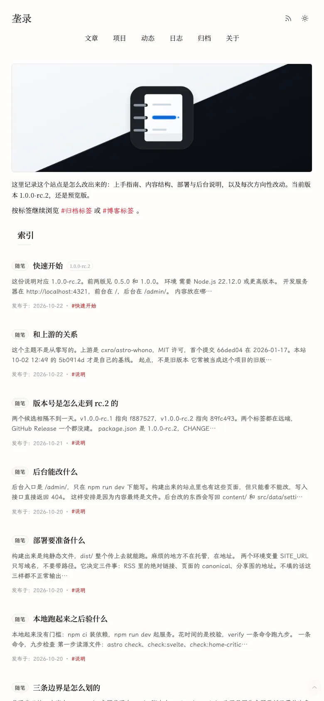

# 架构

> 本页面向开发者，包含实现细节与命令。使用说明见[使用者版](../architecture.md)，全部开发者文档见[索引](README.md)。

主题分成内容、站点代码、构建脚本与静态资源四层。内容放在 `content/`，页面、布局、组件与库在 `src/`，构建与检查在 `scripts/` 与 `tools/`，随站点分发的资源在 `public/`。页面在构建期渲染完整内容，浏览器端只负责筛选、分页与弹窗交互。

## 目录分层

| 路径 | 职责 |
| --- | --- |
| `content/` | 作者内容，按集合分目录；条目目录包含主 Markdown 与 `images/`、`files/`、`assets/` |
| `src/content.config.ts` | 五个集合的 schema 与加载器声明 |
| `src/pages/` | 页面、JSON、RSS、robots 与后台接口；`admin/`、`api/admin/` 在开发环境才可写 |
| `src/layouts/` | `BaseLayout`（壳层、head、字体与统计槽位）与 `ArticleLayout`（文章页、目录、版本导航） |
| `src/components/` | 展示组件；`components/admin/` 只被后台页面引用 |
| `src/lib/` | 内容读取、路由模型、归档、设置解析、Markdown 辅助与后台逻辑 |
| `src/lib/admin-console/` | 后台读写、内容与图片索引、设置校验、写队列与文件事务 |
| `src/lib/fonts/` | 字体注册表与 Astro Fonts API 选择 |
| `src/plugins/` | Markdown 处理、HTML 白名单与关于页指令 |
| `src/integrations/` | 构建期复制内容附件 |
| `src/scripts/` | 浏览器端脚本；`admin-*` 只在开发环境加载 |
| `src/styles/` | 样式入口与组件样式 |
| `src/data/settings/` | 五个设置 JSON |
| `public/` | 静态资源，以及生成的图标与字体 |
| `scripts/` | 检查、字体生成、`new:bit`、`theme:update` |
| `tools/` | 字符集基线、字体清单与生成标记 |
| `tests/` | Vitest 用例与页面快照 |

关键入口：`astro.config.mjs` 负责输出模式、部署 base、集成、字体与 Markdown 处理器；`site.config.mjs` 提供 `SITE_URL`、`CONTENT_ROOT`、默认时区与每页条数；`src/content.config.ts` 与 `src/lib/content-loader.ts` 构成加载层；`src/pages/**` 是路由层；`scripts/*.mjs` 是检查与资产构建层。

## 内容加载与集合

`src/content.config.ts` 用 `entryDirLoader({ collection, fixedPage })` 声明五个集合。加载器在 `src/lib/content-loader.ts`：

- `sync()` 调用 `resolveCollectionEntryFiles()` 找到每个条目的主文件，读取源码、拆分 frontmatter、调用 `context.renderMarkdown` 与 `context.parseData`，再写入 `context.store`，并删除本轮未出现的旧条目。
- 开发环境通过 `context.watcher` 监听集合根目录，`WATCH_DEBOUNCE_MS = 120` 防抖后重新同步。
- 主文件按 `index.md` → 目录内唯一 `.md` → 唯一标了 `entry: true` 的文件依次确定（`src/lib/content-entry-files.ts`）。多个候选或没有候选直接报错；集合根目录下出现 Markdown 文件同样报错。`images`、`files`、`assets` 不作为子条目目录递归。
- `about` 使用固定页面加载器，只读 `content/about/index.md`，条目 ID 固定为 `index`。

`src/lib/content.ts` 的 `getPublished()` 默认在开发环境包含草稿、生产构建排除草稿；开发环境额外用 `existsSync` 过滤已被删除的源文件。日期在 schema 中统一规范化：`date` 必填，`publishedAt`、`updatedAt` 可选，`updatedAt` 不能早于 `date`；项目的 `versions[].date` 不能晚于项目 `date`，且写了 `versions` 就必须有 `versionLabel`。生产构建会缓存排序后的博客与动态查询，并对缺少 `publishedAt` 的博客条目告警。

| 集合 | 内容根 | 主要字段 | 公开输出 |
| --- | --- | --- | --- |
| `blog` | `content/blog/<条目>/` | 标题、日期、系列、版本标签、公开路径、草稿 | `/blog/` 列表与文稿路由 |
| `projects` | `content/projects/<条目>/` | 标题、稳定标识、版本文档字段、历史 `versions` | `/projects/` 卡片与弹窗锚点 |
| `bits` | `content/bits/<条目>/` | 日期、正文、图片、作者、草稿 | `/bits/` 列表与 `#bit-<id>` 锚点 |
| `devlog` | `content/devlog/<项目>/<条目>/` | 标题、所属项目、类型、日期、草稿 | `/devlog/` 列表与 `#<压平 id>` 锚点 |
| `about` | `content/about/index.md` | 正文与关于页指令 | `/about/` |

字段语义、日期显示与写作约定见 [writing.md](writing.md)。

## 路由模型

博客路由在 `src/lib/blog-routing.ts`，不依赖 `astro:content`，后台与脚本可复用。分组键为 `series:<series>` 或 `single:<entry.id>`；排序为日期降序、`versionOrder` 降序、条目 ID 升序。路由类型固定为 `latest-stable`、`latest-dated`、`latest-alias`、`version`：

- 最新版有 `frontmatter.slug` 时走稳定路径 `/blog/<slug>/`，同一系列还会把日期路径生成为指向它的别名；没有稳定路径时走 `/blog/<压平 id>/`。
- 历史版本各生成一条日期路径，带 `noindex`，规范地址指向分组最新版。
- 同一系列的所有版本必须共享一个稳定 slug，冲突或重复路径在构建期抛 `BlogRoutingError`；保留路径名由 `RESERVED_BLOG_SLUGS` 拦截。
- `/blog/[slug].astro` 的 `getStaticPaths` 来自 `getVisibleBlogRouteEntries()`，同时带上上一篇与下一篇。

项目路由在 `src/lib/project-routing.ts`。非日期形式的 `frontmatter.slug` 是稳定键，否则按单版本文档处理；同一稳定键的多个文档按日期、`versionOrder`、ID 排序。最新版锚点为稳定 slug 或压平后的 `YYYY-MM-DD-...`，历史文档锚点为压平后的条目 ID，公开地址为 `/projects/#<anchor>`。旧的内联 `versions[]` 只作为历史元数据展示，`hasDocument: false`，不生成弹窗。锚点冲突直接抛 `ProjectRoutingError`；`resolveProjectAnchor()` 依次匹配锚点、旧条目 ID 与最新版锚点。`buildProjectResolver()` 给 devlog 提供 `projectSlug` → 条目 ID → 唯一显示名的解析顺序。

动态使用单列表页 `/bits/`，锚点由 `getBitAnchorId()` 生成为 `#bit-<entry.id>`（`src/lib/bits-public-routing.ts`）。`src/lib/bits.ts` 负责排序、索引文本与年度筛选项。

归档在 `src/lib/archive.ts`：`getArchiveRows()` 合并博客版本（受 `versionMode` 控制全部或最新）、项目文档版本与 devlog，不包含动态；排序为日期降序、`versionOrder` 降序、ID 升序；`groupArchiveRows()` 按年月分组。`versionMode` 来自 `page.archive.versionMode`。`/archive/`、`/blog/`、`/bits/` 各自的 `index.json` 为浏览器端筛选、搜索与计数提供数据；分页由页面上的 `data-page-size` 与已渲染条目计算。其中 `/blog/index.json` 的 `isLatest` 也用于构建后的 sitemap 过滤。

站内链接统一走部署 base：`ASTRO_WHONO_BASE_PATH` 在 `astro.config.mjs` 中归一化为 `/` 或 `/<segment>/`，`trailingSlash` 固定为 `always`。`withDeploymentBase()`（`src/plugins/markdown-pipeline.mjs`）与 `createWithBase()`（`src/utils/format.ts`）分别处理 Markdown 正文与源码链接。`SITE_URL` 为空时不注册 sitemap、robots 不写 sitemap 行、canonical 与 og:url 省略。

## 开发与生产运行模式

`astro.config.mjs` 用 `NODE_ENV` 选择 `output`：`astro dev` 为 `server`，`astro build` 为 `static`。Svelte 集成只在非生产构建注册，后台的交互岛因此只在开发环境出现。

后台写入边界由 `import.meta.env.DEV` 控制：

- `theme`、`content`、`resources`、`data` 四个后台页面在构建期照常生成，但 `isDev` 为假时渲染 `AdminReadonlyNotice`，不渲染表单与后台脚本；概览页按 `adminOverview.publicVisible` 渲染公开概览或隐藏提示。`/admin/content/<集合>/_edit/<条目 ID>/` 的 `getStaticPaths` 在生产构建返回空数组（`src/pages/admin/content/[collection]/[edit]/[...entryId].astro`）。后台页面带 `noindex`，并被 sitemap 过滤器排除。
- `/api/admin/**` 的处理函数在非开发环境返回 404。内容条目、图片、媒体、预览与站点图标上传接口额外放行 `process.env.VITEST`，便于测试直接调用。
- 写入请求先通过 `validateAdminJsonWriteRequest()` 或 `validateAdminFormDataWriteRequest()`：JSON 写入要求 `application/json`，上传要求 `multipart/form-data`，且 `Origin`（或 `Referer`）必须与当前站点同源，否则返回 415 或 403。

静态构建时，带 GET 处理函数的接口会被执行一次，产物是 `dist/api/admin/**` 下的 `Not Found` 文本；只有 POST、没有 GET 的接口直接生成 Astro 404 页面。`npm run check:prod-artifacts` 断言这些产物不泄漏 API JSON、不包含后台路由导航。

公开页面在构建期渲染完整列表与正文，无 JavaScript 也能阅读与导航；筛选、搜索、分页与弹窗只操作已渲染的页面，`index.json` 补充计数与筛选项。浏览器端入口在 `src/scripts/`，由布局或页面以模块脚本引入，`admin-*` 只在开发环境加载。浏览数据只提供槽位契约：布局渲染 `[data-view-stats]` 与 `[data-view-stat="pv|uv"]`，`src/lib/view-stats.ts` 定义读写与 `astro-whono:view-stats-ready` 事件，站点在 `src/scripts/view-stats.ts` 里自取数据。

## 设置解析

设置是 `src/data/settings/` 下的五个 JSON：`site.json`、`shell.json`、`home.json`、`page.json`、`ui.json`。文件组与相对路径常量在 `src/lib/theme-settings.ts` 的 `SETTINGS_FILE_GROUPS`、`SETTINGS_RELATIVE_PATHS`，`getThemeSettingsFilePath()` 负责定位。

`getThemeSettings()` 逐字段用 `resolveValue(newValue, legacyValue, defaultValue)` 解析，并把来源记为 `new`、`legacy` 或 `default`；缺失或非法类型回退到默认值，旧版默认值由 `LEGACY_*` 常量提供。读取阶段的诊断由 `getThemeSettingsReadDiagnostics()` 产生，代码为 `invalid-json`、`invalid-root`、`read-failed`、`schema-mismatch`；`schema-mismatch` 表示字段会在读取时被静默修补，诊断只影响后台能否保存，不影响页面渲染。开发环境不做缓存（`shouldCacheThemeSettings = import.meta.env.PROD`），手动改 JSON 后刷新即可；生产构建缓存解析结果。

可编辑快照带 `revision`，由 `getThemeSettingsRevision()` 对规范化后的快照做 SHA-1 得到，快照与来源一起由 `getEditableThemeSettingsPayload()` 输出。`getEditableThemeSettingsState()` 在有诊断时返回 `{ ok: false, mode: 'invalid-settings' }`，后台据此禁用保存。

保存流程在 `src/pages/api/admin/settings.ts`：请求必须提交完整 canonical 快照与 `revision`；revision 过期时返回 409 和最新快照，只写发生变化的文件组，`?dryRun=1` 只返回变更预览。写入成功后调用 `resetThemeSettingsCache()` 再重新读取，读取失败返回 500 并提示先修复文件。

`ui.typography` 是例外：字体选择在 Astro 配置期读取，`resolveTypographyFromRawUiSettings()` 与 `getSelectedAstroApiFonts()`（`src/lib/fonts/registry.ts`）把选中的 Astro Fonts API 条目注册进 `fonts`；`BaseLayout` 用 `import.meta.env.ASTRO_WHONO_FONT_CSS_VARIABLES` 快照过滤 ``，开发中热改字体只告警并跳过渲染，重启开发服务器后生效。

## 布局、样式与检查

样式入口是 `src/styles/global.css`，引入 `src/styles/components/layout.css` 等公共组件样式与 `fonts.generated.css`；页面私有样式在 `home.css`、`article.css`、`bits-page.css`、`archive-page.css`、`projects-page.css`、`devlog-page.css`、`about.css`，后台样式在 `src/styles/components/admin/`。

桌面壳层是三列栅格 `var(--sidebar) 1px 1fr`，`--sidebar: 224px`，分隔线 1px；`900px` 及以下切换为单列，桌面规则从 `901px` 起。页面外缘间隙由 `site.pageGapPx` 控制（32–160，默认 32），`BaseLayout` 把 `--page-gap-inline` 与 `--page-inline`（间隙减去 `SCROLLBAR_GUTTER_INLINE_PX = 15`）写到 `<html>` 内联样式；窄屏浮动列到右缘的距离由 `site.railOffsetPx` 控制（0–32，默认 6），写入 `--rail-action-offset-narrow`，窄屏 CSS 只能以 `var(--rail-action-offset-narrow, 6px)` 形式引用。

首页 critical CSS 是 `src/pages/index.astro` 里的 `homeHeadCriticalCss` 手写快照，以 `String.raw` 数组拼装，通过 `BaseLayout` 的 `head` 插槽输出在 `global.css` 之后。相关检查：

| 命令 | 检查对象 |
| --- | --- |
| `npm run check:home-critical-css` | 快照与 `global.css`、`components/layout.css` 的声明是否漂移 |
| `npm run check:layout-geometry` | 读取 `dist` CSS 与 `<html>` 内联变量，校验间距、热区净空与浮动列偏移 |
| `npm run check:touch-targets` | 构建产物里交互元素的最终热区不小于 44px |
| `npm run check:viewport-overflow` | 滚动条槽、`overflow: clip` 回退与窄屏悬停提示的溢出约束 |

字体由两层组成：`fonts.generated.css` 的基础分片始终加载；`ui.fontCoverage = 'full'` 时 `BaseLayout` 额外预加载 `fonts.dlc.generated.css` 的生僻字分片。两个文件都由 `npm run font:subset` 生成（`font:build` 负责编排），字体文件放在 `public/fonts/`，运行时没有第三方字体请求。站点图标由 `scripts/favicon.mjs` 在 `predev`、`prebuild` 阶段生成到 `public/images/site/generated/`，源图顺序为 `png`、`source`、`svg`，根 `public/favicon.ico` 只在仍是生成版本时覆盖，标记写在 `tools/favicon-generated.json`；细节见 [favicon.md](favicon.md)。

## Markdown 处理管线

公开页面的处理器由 `src/plugins/markdown-pipeline.mjs` 的 `createPublicMarkdownConfig({ base })` 组装，在 `astro.config.mjs` 中作为 `markdown.processor` 传入。Astro 内建的 GFM 与智能标点先执行，项目插件随后处理：

- remark：`remark-math`（`singleDollarTextMath: false`，单个 `$` 不是公式定界符）、`remark-directive`、文本指令还原、关于页指令、提示块。
- rehype：数学边界保护与还原、`rehype-raw`、关于页指令、内容附件链接改写、部署 base 改写、共享白名单清洗、KaTeX 渲染。
- 代码高亮：Shiki，浅色 `github-light`、深色 `github-dark`，另有代码块工具栏转换器。

白名单在 `src/plugins/sanitize-schema.mjs`：以 `rehype-sanitize` 的 `defaultSchema` 为底，追加 `figure`、`figcaption`、`details`、`summary`、`dialog`、`button`、`svg`、`path`、`rect` 等标签，以及提示块、图注、画廊、代码工具栏、关于页复制按钮所需的 `class`、`data-*` 与 `aria-*` 属性。末尾链接组由 `src/lib/trailing-links.ts` 解析并在清洗之外手工生成 HTML，因此该模块按 `http`、`https`、`mailto`、`tel` 白名单再校验一次协议。

后台预览使用独立处理器（`src/lib/admin-console/preview.ts`）：remark 侧补 `remark-gfm` 与 `remark-smartypants`，rehype 侧用 `@shikijs/rehype` 做高亮，其余项目插件与 `sanitizeSchema` 共用。差异只在标题 ID（预览用 `data-admin-outline-key`）与预览专用的本地图片地址、关于页链接占位。

正文末尾链接组机制只在 `projects` 与 `devlog` 生效：`renderEntryBody()`（`src/lib/entry-body.ts`）先剥离链接组再渲染正文，随后追加统一的链接行；摘要派生也基于剥离后的正文。内容附件（PDF、压缩包等非图片、非 Markdown 文件）由 `src/integrations/content-assets.mjs` 在 `astro:build:done` 时复制到 `dist/content-assets/<内容相对路径>`，只复制被 Markdown 或 HTML 链接引用的文件；开发环境由 Vite 中间件在 `/content-assets/` 提供同一路径。

## 后台页面与接口

后台页面路由定义在 `src/lib/admin-console/routes.ts`：`/admin/`（概览）、`/admin/theme/`（主题设置）、`/admin/content/`（写作）、`/admin/resources/`（资源）、`/admin/data/`（快照）。内容编辑页为 `/admin/content/<集合>/_edit/<条目 ID>/`，只在开发环境生成；`/admin/images/` 在 `astro.config.mjs` 中重定向到 `/admin/resources/`。

接口在 `src/pages/api/admin/`，路径常量集中在 `src/lib/admin-console/admin-api-paths.ts`，分为八组：内容条目与批量操作（`content/`）、内容附件（`content/files/`）、设置（`settings.ts`）、快照设置（`data/settings.ts`）、图片（`images/`）、媒体（`media/`）、预览（`preview/`）与站点资源上传（`site-assets/`）。集合的读写能力以 `src/lib/admin-console/content-collections.ts` 为唯一来源，`writable`、`entryWritable`、`create`、`deletable`、`draftStatus` 等能力同时约束页面与接口。

写入串行化由 `createAdminWriteQueue()`（`src/lib/admin-console/admin-api.ts`）实现：内部用 Promise 链排队。设置保存与站点资源上传共用 `withAdminSettingsWriteLock`，内容写入使用 `withAdminContentWriteLock`（`src/lib/admin-console/content-write-lock.ts`），两条队列互不阻塞。设置与内容条目的文本写入经 `persistAdminFileTransaction()`：先写临时文件，再备份旧文件并重命名提交，失败时按逆序回滚；图片、媒体与站点资源的上传和改名是单文件写入，用排他创建或直接重命名处理冲突。

冲突处理：设置保存比较 `revision`，不一致返回 409 与最新快照；内容条目在构建写计划前比较编辑器载荷的 `revision`，并在 `beforeWrite` 回调里再查一次，不一致返回 409 与最新载荷。`isAdminDryRunRequest()` 识别 `?dryRun=1`，只返回变更字段或文件组预览，不落盘。

## 构建流程

`npm run dev` 先执行 `predev` 的 `scripts/favicon.mjs`，再启动 `astro dev`；`npm run build` 先执行 `prebuild` 的同名生成器，再执行 `astro build`。构建期的主要动作：

1. 配置期读取 `site.config.mjs`、`site.json` 与 `ui.json`，确定 `base`、`output`、字体注册、sitemap 是否注册与 Markdown 处理器。
2. 五个集合的加载器读取内容，渲染 Markdown 并生成页面、`/blog|bits|archive/index.json`、RSS、robots 与 sitemap。
3. `astro:build:done` 阶段复制被引用的内容附件，并按 `/blog/index.json` 的 `isLatest` 允许列表删除 sitemap 中的历史版本与日期别名 URL。

`npm run verify` 的顺序固定为：`check`（类型与 Svelte 检查、后台源码边界、首页 critical CSS、图片引用、字体字符集与字体检查）→ `build` → `font:coverage --strict` → `test:fixtures` → `test` → `check:prod-artifacts` → `check:layout-geometry` → `check:touch-targets` → `check:viewport-overflow`。`SITE_URL` 与 `ASTRO_WHONO_BASE_PATH` 的行为见 [deployment.md](deployment.md)，主题更新对站点自有路径的保护见 [upstream.md](upstream.md)。

命令细节与测试组织见 [development.md](development.md)，后台页面与设置字段见 [admin-console.md](admin-console.md)。
