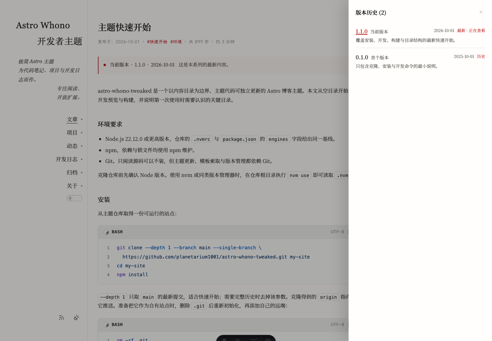
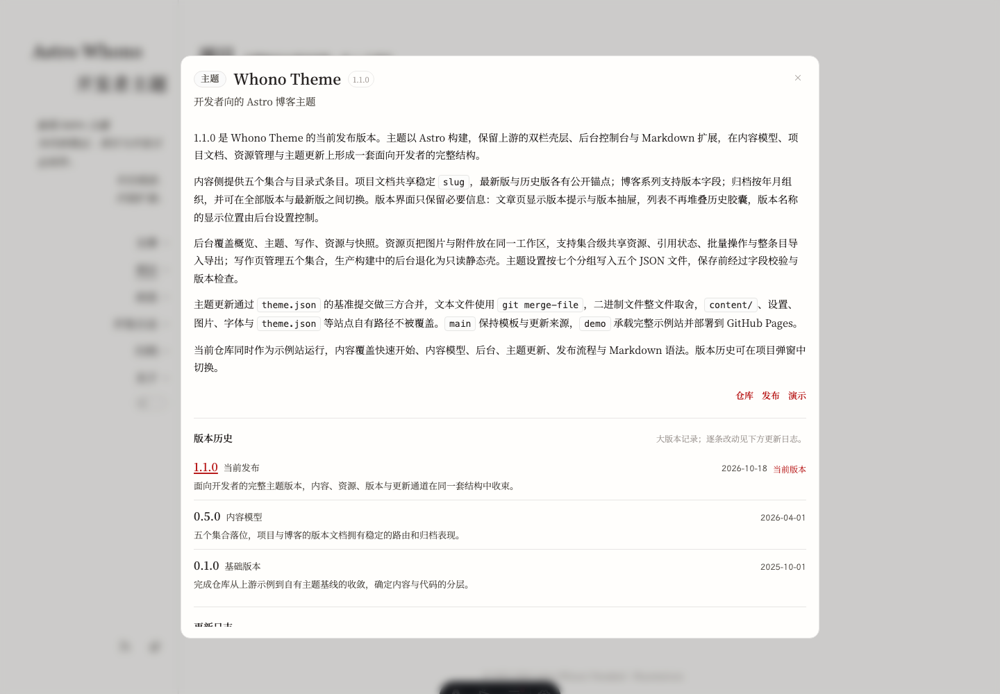

# 写作与内容约定

## 集合与入口

| 集合 | 源文件 | 公开路由 |
| --- | --- | --- |
| `blog` | `content/blog/<entry>/index.md` | `/blog/`、`/blog/<slug>/` |
| `projects` | `content/projects/<entry>/index.md` | `/projects/`、`/projects/#<anchor>` |
| `bits` | `content/bits/<entry>/index.md` | `/bits/` 页内锚点 |
| `devlog` | `content/devlog/<projectSlug>/<entry>/index.md` | `/devlog/` 页内锚点 |
| `about` | `content/about/index.md` | `/about/` |

三种写作入口：

- 后台写作页 `/admin/content/`：新建与编辑，按标题生成条目 ID；仅开发环境可写；
- 在对应集合目录新增条目目录与 `index.md`，目录名遵循 [development.md](development.md) 的 `YYYY-MM-DD-title` 规范；
- `npm run new:bit`：在 `content/bits/` 生成一条草稿。

条目必须放在目录中，集合根目录下的 Markdown 文件会被拒绝。目录内主文件按以下顺序确定：`index.md`、唯一的 `.md`、唯一标记 `entry: true` 的文件。`about` 是固定单页，不使用条目目录。

`draft: true` 只在开发环境可见；生产构建、公开列表与 RSS 会过滤。

## frontmatter

`date` 接受 `YYYY-MM-DD`、`YYYY/MM/DD` 或日期时间；没有时区偏移的值按站点时区解释。`slug` 统一要求小写 kebab-case，允许中文；`entry` 是主文件选择标记，不参与公开字段。

### blog

| 字段 | 必填 | 说明 |
| --- | --- | --- |
| `title` | 是 | 标题 |
| `date` | 是 | 发布日期 |
| `description` | 否 | 摘要；留空时从正文截取 |
| `tags` | 否 | 字符串数组，默认空 |
| `draft` | 否 | 默认 `false` |
| `publishedAt` | 否 | 日期或日期时间；用于日期显示与 RSS，缺失时回退 `date` 并在生产构建告警 |
| `updatedAt` | 否 | 日期或日期时间，不得早于 `date` |
| `slug` | 否 | 公开路径；默认使用完整条目 ID，因此含日期前缀 |
| `ogImage` | 否 | 分享图：条目内相对图片、`https://` 地址或 `none`；未填不输出分享图 |
| `ogImageAlt` | 否 | 分享图替代文本 |
| `articleDateDisplay` | 否 | 文章日期显示：`published`、`updated`、`both` |
| `cardDateDisplay` | 否 | 卡片日期显示：`published`、`updated`、`both` |
| `dateGranularity` | 否 | `date` 或 `datetime`，覆盖文章元信息粒度 |
| `badge` | 否 | 标题前的纯文本角标 |
| `series` | 否 | 系列键，小写 kebab-case；同一系列的不同版本文档共用 |
| `versionLabel` | 否 | 版本号，例如 `1.0.0` 或 `1.0.0-rc.1` |
| `versionName` | 否 | 版本名称，默认取标题 |
| `versionSummary` | 否 | 版本摘要 |
| `versionOrder` | 否 | 非负整数，同日期时的排序依据 |

`ogImage` 的本地路径相对于条目目录，例如条目内 `images/share.webp`。`ogImage: none` 显式关闭分享图。

### bits

| 字段 | 必填 | 说明 |
| --- | --- | --- |
| `date` | 是 | 日期或日期时间 |
| `title` | 否 | 动态可以没有标题 |
| `description` | 否 | 摘要 |
| `tags` | 否 | 字符串数组，默认空 |
| `draft` | 否 | 默认 `false` |
| `slug` | 否 | 检索索引的稳定键；页内锚点仍使用条目 ID |
| `images` | 否 | 数组，每项 `src` 必填、`alt` 可选；`src` 为条目内相对图片或 `https://` |
| `author` | 否 | `name` 与 `avatar` 可选；`avatar` 是相对 `public/` 的图片路径 |

`author.avatar` 不写前导斜杠、不写 `public/`，例如 `author/avatar.svg`；未填时使用 `page.json` 的 `bits.defaultAuthor`。

### projects

| 字段 | 必填 | 说明 |
| --- | --- | --- |
| `title` | 是 | 项目标题 |
| `date` | 是 | 当前版本文档的日期 |
| `subtitle` | 否 | 副标题 |
| `description` | 否 | 摘要 |
| `type` | 否 | 自由文本，渲染为标题前胶囊 |
| `icon` | 否 | 卡片图标，条目内相对图片或 `https://` |
| `image` | 否 | 卡片缩略图，条目内相对图片或 `https://` |
| `slug` | 否 | 项目稳定键；同一项目的多个版本文档共享 |
| `versionLabel` | 否 | 当前版本号 |
| `versionName` | 否 | 当前版本名称 |
| `versionSummary` | 否 | 当前版本摘要 |
| `versionOrder` | 否 | 非负整数，同日期排序 |
| `versions` | 否 | 旧版内联历史，仅保留元数据；使用独立版本文档时不必填 |
| `draft` | 否 | 默认 `false` |

`versions[]` 每项包含必填 `label` 与 `date`，以及可选 `name`、`summary`、`order`。填写 `versions` 时，当前文档必须有 `versionLabel`；历史版本日期不得晚于项目 `date`。

`projects` 没有 `tags`、`repo`、`demo` 字段。仓库、演示等外链写在正文末尾链接组。

### devlog

| 字段 | 必填 | 说明 |
| --- | --- | --- |
| `title` | 是 | 标题 |
| `date` | 是 | 日期 |
| `project` | 是 | 项目显示名，自由文本，不做链接 |
| `projectSlug` | 否 | 项目稳定 `slug`；也接受项目条目 ID 或版本锚点 |
| `kind` | 否 | 自由文本，建议 `feature`、`fix`、`improvement`、`breaking`、`docs` |
| `description` | 否 | 摘要 |
| `draft` | 否 | 默认 `false` |

`devlog` 没有 `links` 字段，外链写在正文末尾链接组。`devlog` 按项目分目录存放：`content/devlog/<projectSlug>/<entry>/index.md`。页面锚点会把目录分隔压成 `-`，例如 `#versicarium-2026-10-14-content-model-and-navigation`。

`projectSlug` 依次按项目稳定 slug、任一版本文档的条目 ID、版本锚点解析；未命中时回退到 `project` 显示名，且仅在显示名唯一匹配时生效。非空但未解析的值会在构建期告警。

### about

`about` 的 schema 不约束字段，正文写在 `content/about/index.md`。关于页专用的指令只在在解析该文件时启用。

## 博客系列与版本

同一 `series` 的多篇博客视为不同版本，按日期降序、`versionOrder` 降序、条目 ID 升序确定最新版。

- 不写 `slug` 时，最新版与其他版本都使用带日期的条目 ID 路径，最新版路径即 canonical。
- 写 `slug` 时，系列内所有版本必须使用同一个值；最新版获得 `/blog/<slug>/`；若稳定路径与最新版日期路径不同，另保留一条指向同一内容的日期别名，canonical 指向稳定路径。
- 历史版本始终保留 `/blog/<条目ID>/` 路径，并以 `noindex` 标记；RSS 与 sitemap 只包含每个系列的最新版。
- `slug` 不能是 `page` 或 `rss.xml`；与静态路由冲突会在构建期失败。
- 修改已发布系列的 `slug` 会改变 canonical 路径，应视为破坏性改动。

后台写作页的“新建版本”只适用于 `blog`：它以系列最新版为模板复制草稿，并重新生成条目 ID。



## 项目多版本文档

同一项目的每个版本写一个独立目录与 `index.md`，所有版本文档共享同一个非日期形式的 `slug`：

```text
content/projects/your-project/index.md                 # 最新版，slug: your-project
content/projects/2026-04-01-your-project/index.md      # 历史版
content/projects/2025-10-01-your-project/index.md      # 历史版
```

- `/projects/` 每个项目只显示最新版卡片；点击卡片打开弹窗，弹窗内可切换全部文档版本。
- 最新版锚点为 `#<slug>`，例如 `/projects/#your-project`。
- 历史版锚点为条目目录压平成单段的日期锚点，例如 `/projects/#2026-04-01-your-project`。
- 版本按日期降序、`versionOrder` 降序、条目 ID 升序排列；`versionOrder` 重复时构建期告警。
- 没有 `slug`，或 `slug` 本身写成 `YYYY-MM-DD-title` 时按单版本处理，锚点使用目录压平值。
- 不同项目产生相同锚点时构建失败；修改已发布项目的 `slug` 会改变公开锚点，并可能断开开发日志关联。
- 旧的内联 `versions[]` 只在版本历史中显示元数据，不生成可打开的弹窗。



## 图片与附件

| 位置 | 写法 |
| --- | --- |
| 正文 Markdown 与 HTML | 相对条目目录，或以 `/` 开头按 `public/` 解析 |
| `ogImage`、`projects.icon`、`projects.image`、`bits.images[].src` | 相对条目目录的图片，或 `https://` |
| `bits.author.avatar`、`page.bits.defaultAuthor.avatar` | 相对 `public/`，不带前导斜杠 |
| 条目附件 | 相对条目目录的 `files/` 路径；构建时复制到 `/content-assets/` |

正文图片示例：

```markdown


```

条目附件只复制被 Markdown 链接或 HTML `href` 引用的文件：

```markdown
[下载清单](files/checklist.pdf)
```

`npm run check:image-references` 会检查 Markdown、HTML `src`/`srcset`、frontmatter 与设置 JSON 中的本地图片引用；外链与模板表达式跳过。

## 末尾链接组

`projects` 与 `devlog` 的正文末尾可以写一组外链，渲染为右对齐链接行：

```markdown
项目正文的最后一段。

[仓库](https://github.com/planetarium1001/astro-versicarium) · [文档](https://github.com/planetarium1001/astro-versicarium/tree/main/docs)
```

- 链接组前留一个空行，与正文分成两段。
- 链接组是文末连续若干行，每行只由 Markdown 链接与分隔符（空白或 `·|、,，/`）构成，一行可放多个链接。
- 渲染时按书写顺序排列，只留等距间隔，不输出分隔符。
- 链接组不参与摘要派生，也不会在正文中重复出现。
- `blog` 不使用这套机制，正文中的链接按普通 Markdown 渲染。

## 提示块

```markdown
:::tip[提示]
支持 note、tip、info、warning 四种类型，标签可省略。
:::
```

## 图注

```html
<figure class="figure figure--md figure--center">
  
  <figcaption>图注文字</figcaption>
</figure>
```

必须保留 `figure` 基础类。尺寸类 `figure--sm`、`figure--md`、`figure--lg`、`figure--full` 与对齐类 `figure--left`、`figure--center`、`figure--right` 各取一个；省略时按居中排版。

## 画廊

```html
<ul class="gallery cols-2">
  <li>
    <figure>
      
      <figcaption>图注</figcaption>
    </figure>
  </li>
</ul>
```

`ul` 需要 `gallery` 类，列数追加 `cols-2` 或 `cols-3`；只有 `gallery` 时按缺省网格排列，没有 `gallery` 时按普通无序列表渲染。

## 公式

行内公式使用 `$$...$$`，块级公式把 `$$` 单独成行：

```markdown
行内公式 $$a^2 + b^2 = c^2$$。

$$
\int_0^1 x^2 \, dx
$$
```

单个 `$` 不是公式定界符；代码块与行内代码中的 `$$` 原样输出。

## 代码块

使用围栏代码块并标注语言。渲染时套上工具栏，显示语言、行数与复制按钮；行号由后台“代码显示 → 代码块行号”控制。

````markdown
```ts
export const add = (a: number, b: number): number => a + b;
```
````

## 折叠内容

```markdown
<details>
  <summary>标题</summary>

  折叠的正文。

</details>
```

## 关于页指令

下列指令只在 `content/about/index.md` 中生效：

```markdown
::site-info{name="站点名" url="https://example.com" description="一句话简介" avatar="author/avatar.svg"}

:::friend{name="友站" url="https://example.com" avatar="author/avatar.svg"}
友站简介
:::

:::faq{question="问题标题"}
回答正文
:::

::contact-links
```

`site-info` 的四个属性均可选，渲染为站点信息卡片。`friend` 需要 `name` 与 `url`，正文为简介；连续的 `friend` 组成友链卡片列表。`faq` 需要 `question`，正文为回答；连续的 `faq` 组成问答列表。`contact-links` 输出 `site.json` 中配置的社交联系方式。
